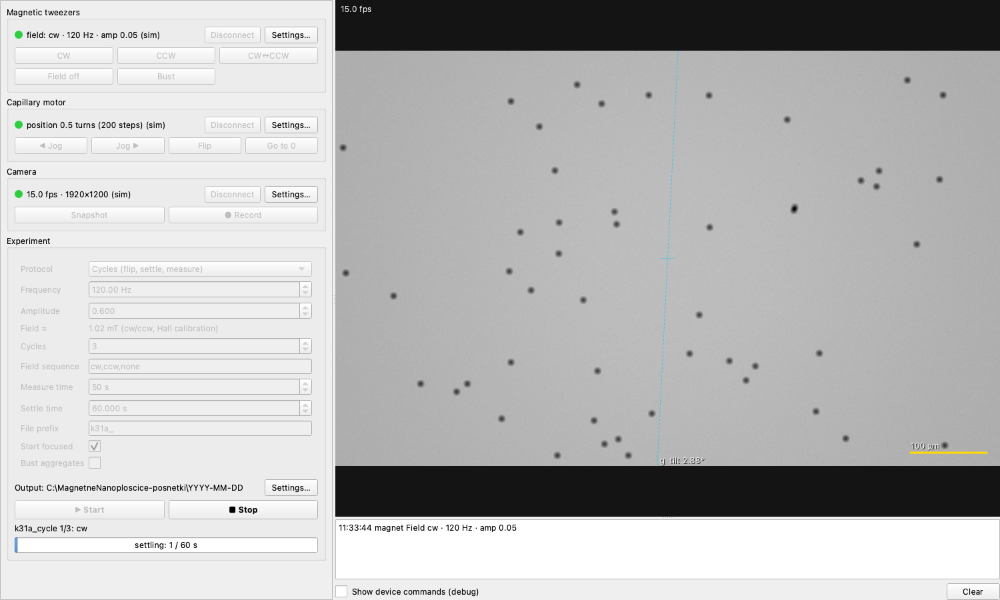

# OddViscosityExperiment

Control software for an experiment that looks for **odd viscosity** in a chiral
fluid: silica beads sediment through a suspension of magnetic nanoplatelets
that a rotating magnetic field keeps spinning. The beads' sideways drift, and
how it changes with the sense of rotation (CW / CCW / alternating control), is
the signal.

The GUI runs the whole measurement:

- **Magnetic tweezers** – 4 coils (2 per axis, in series) driven by the
  *pinceta* server over TCP; arbitrary rotating fields from waveform banks.
- **Capillary rotator** – Arduino + stepper motor on a serial port; flips the
  capillary so the beads sediment back across the channel between measurements.
- **Camera** – FLIR/Point Grey camera through **PySpin** (Spinnaker SDK), live view
  and recording to `.twv` (the format of the previous FlyCapture2 tool, so
  existing tracking and analysis tools keep working).



## Installation

The project is managed with [uv](https://docs.astral.sh/uv/).

```bash
# install uv once:  https://docs.astral.sh/uv/getting-started/installation/
#   macOS/Linux:  curl -LsSf https://astral.sh/uv/install.sh | sh
#   Windows:      powershell -ExecutionPolicy ByPass -c "irm https://astral.sh/uv/install.ps1 | iex"
uv sync            # creates .venv with Python 3.10 and all dependencies
uv run odd-viscosity-gui
```

Or double-click **`run_gui_windows.bat`** / **`run_gui_mac.command`**, which do the
same (and install everything on the first start). The launchers keep the
environment on the local disk – `%LOCALAPPDATA%\OddViscosityExperiment\venv`
(Windows), `~/Library/Caches/OddViscosityExperiment/venv` (macOS) – so the
repository can live on a network drive shared between computers (a `.venv` on an
SMB share fails and would clash between Windows and macOS). To use the same
environment from a terminal, set `UV_PROJECT_ENVIRONMENT` to that path.

### Camera (PySpin)

PySpin is not on PyPI. Install the **Spinnaker SDK** from FLIR (Teledyne), then add
the Python wheel that comes with it, matching the project's Python version
(3.10, see `.python-version`), to the environment the GUI runs in:

```bat
rem Windows, environment used by run_gui_windows.bat
uv pip install --python "%LOCALAPPDATA%\OddViscosityExperiment\venv" ^
    path\to\spinnaker_python-<version>-cp310-cp310-win_amd64.whl
```

(For a `.venv` in a local clone: `uv pip install path/to/the.whl`.)

`uv run` keeps this extra package; a plain `uv sync` removes it again (use
`uv sync --inexact`, or reinstall the wheel). If `import PySpin` complains about
NumPy, pin an older NumPy for that SDK version (`uv add "numpy<2"`).

Close SpinView and other camera programs before connecting – only one program
can open the camera.

### Without hardware

Every device has a **Simulate** option (default on macOS/Linux): commands are
only logged and the camera produces synthetic sedimenting beads. All protocols
can be tried out this way.

## Using the GUI

- **Left third** – one box per device: status light, *Connect*, *Settings…*
  (connection and device options in their own window) and quick actions
  (field CW / CCW / CW↔CCW / off / bust; motor jog / flip / go to 0; camera
  snapshot / record). Below them the **Experiment** box: protocol and its
  parameters, *Start* / *Stop*, progress. *Settings…* there holds the output
  folder, waiting times, proxy field and bust parameters.
- **Right two thirds** – live image (overlay: gravity direction at the camera
  tilt, scale bar, cursor pixel value, REC indicator) and the log.

Settings are stored per user and computer (not in the repository):
`%APPDATA%\OddViscosityExperiment` (Windows),
`~/Library/Application Support/OddViscosityExperiment` (macOS),
`~/.config/OddViscosityExperiment` (Linux); override with the environment
variable `ODD_VISCOSITY_CONFIG_DIR`. Each day's log is written as
`experiment_log_<date>.txt` next to the recordings.

### Protocols

| Protocol | What it does |
|---|---|
| **Cycles** | for each cycle: flip, let the beads settle (weak field), flip back, field on, record, field off |
| **Control** | like *Cycles* with the field off (`<prefix>cycle=<n>_cntrl`); needs no magnet |
| **Frequency/amplitude scan** | *Cycles* for every (frequency, amplitude), then an optional control run |
| **Flow** | no motor: field cycles bracketed by field-off controls |
| **Flip only** | flip every interval to keep beads from sticking to the walls (optional aggregate busting) |

Only the devices a protocol uses must be connected: *Control* and *Flip only*
(without busting) run without the magnet, *Flow* without the motor; *Cycles*
and *Flow* need the magnet only if the sequence contains a field.

**Field sequence** (repeated cyclically): `cw`, `ccw`, `none` (one turn CW, one
CCW, starting vertical – the achiral control), `none_x` / `none_y` (alternating,
start axis written into the filename), `cntrl` (field off). How each mode is
produced – waveform bank, phase, frequency and amplitude factor per axis – is an
editable table in the magnet settings.

**Start focused** – checked: the beads lie on the bottom wall in the current
orientation, so the first cycle flips, settles and flips back. Unchecked: the
capillary is upside down with the beads settled, and one flip starts the first
measurement. The motor position at *Start* is taken as the measuring orientation;
use *Jog* to align the capillary before starting.

**Stop** aborts immediately, also during waits; the recording is closed and the
field switched off.

### Output

```
<output folder>/<YYYY-MM-DD>/
    <prefix>cycle=<n>_field=<cw|ccw|none>.twv      recording
    <prefix>cycle=<n>_field=<…>.json               sidecar: protocol, field, f, amp, times,
                                                   frame counts, all device settings
    <prefix>cycle=<n>_cntrl.twv                    field-off control
    <prefix>_control-before-<n>_field=cntrl.twv    flow protocol controls
    experiment_log_<date>.txt
```

Existing files are never overwritten (`_2`, `_3`, … is appended). The `.twv`
format is described in [docs/hardware.md](docs/hardware.md);
`odd_viscosity_experiment.twv.read_header` / `read_frame` read it.

## Development

```bash
uv run pytest                 # tests use simulated devices only
uv run python -m odd_viscosity_experiment
uv add <package>              # add a dependency (updates pyproject.toml and uv.lock)
```

```
src/odd_viscosity_experiment/
    settings.py    all options (dataclasses -> JSON; settings forms are generated from field metadata)
    magnet.py      tweezers TCP client and field modes
    motor.py       Arduino stepper (serial, absolute steps)
    camera.py      PySpin acquisition thread, simulated camera, recording
    twv.py         .twv writer/reader
    protocols.py   protocols and runner (worker thread, abort, cleanup, sidecars)
    ui/            main window, device panels, settings dialogs, camera view, log
tests/             pytest, simulated devices
docs/hardware.md   device protocols, calibration notes, file format
```

The device and protocol modules do not depend on Qt and can be scripted
directly, e.g.

```python
from odd_viscosity_experiment.settings import AppSettings
from odd_viscosity_experiment.magnet import Magnet

settings = AppSettings.load()
magnet = Magnet(settings.magnet)
magnet.connect()
magnet.set_field('cw', freq=120, amp=0.6)
magnet.disable()
```
